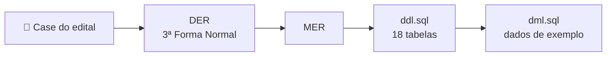
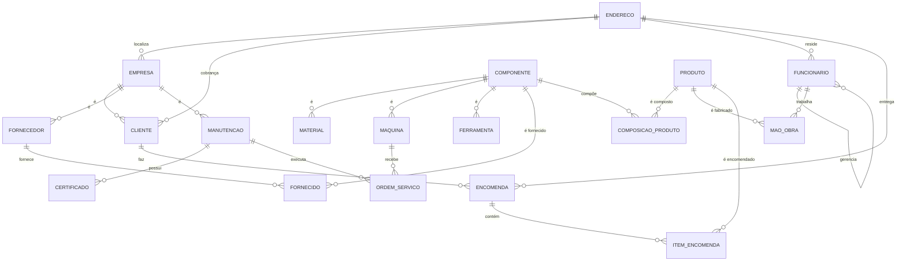

# 🪵 Madeira Verde — Modelagem do Banco de Dados


> Do case ao banco: DER, MER e scripts SQL para o sistema de uma fábrica de móveis sob encomenda.

Este repositório reúne a A3 da disciplina **Modelagem de Software**, do curso de **Ciência da Computação** da **Universidade Anhembi Morumbi**. O trabalho, feito em grupo, modela o banco de dados da **Fábrica de Móveis Madeira Verde**, que produz móveis apenas por encomenda para varejistas e precisa controlar clientes, produtos, componentes, fornecedores, funcionários, encomendas e a manutenção das máquinas. O modelo foi desenhado no **DBDesigner** e codificado em SQL para o **MariaDB**.



---

## ✨ O Problema

A Madeira Verde não mantém estoque de produtos prontos: cada encomenda dispara a fabricação. Para entregar no prazo, a empresa precisa saber:

- **O que cada produto consome**: matérias-primas, materiais, máquinas, ferramentas e mão de obra.
- **De quem comprar**: fornecedores de cada componente, para que nenhum item falte.
- **Quem encomendou o quê**: clientes pessoa jurídica, produtos, quantidades, valores e forma de pagamento.
- **Como estão as máquinas**: manutenções feitas por empresas especializadas.

## 🚀 A Solução

- **Superentidades** `EMPRESA` e `COMPONENTE` concentram os atributos comuns e são especializadas em cliente, fornecedor e manutenção, e em material, máquina e ferramenta.
- **Tabelas associativas** resolvem os relacionamentos N:N: composição do produto, fornecimento, mão de obra, itens da encomenda e ordens de serviço.
- **Endereço normalizado** em uma tabela reaproveitada por empresas, clientes, funcionários e encomendas.
- **Autorrelacionamento** em `FUNCIONARIO` para a hierarquia de subordinação.

---

## 🛠️ Stack Tecnológica

| Camada | Tecnologia |
|---|---|
| **Modelagem** | DBDesigner (DER e MER) |
| **Banco de dados** | MariaDB (compatível com MySQL) |
| **Scripts** | SQL — DDL e DML |
| **Documentação** | Markdown com diagramas Mermaid |

---

## 🗂️ Modelo Entidade-Relacionamento



| Grupo | Tabelas |
| :--- | :--- |
| **Empresas** | `EMPRESA`, `CLIENTE`, `FORNECEDOR`, `MANUTENCAO`, `CERTIFICADO` |
| **Componentes** | `COMPONENTE`, `MATERIAL`, `MAQUINA`, `FERRAMENTA`, `FORNECIDO` |
| **Produção** | `PRODUTO`, `COMPOSICAO_PRODUTO`, `FUNCIONARIO`, `MAO_OBRA`, `ORDEM_SERVICO` |
| **Vendas** | `ENCOMENDA`, `ITEM_ENCOMENDA` |
| **Apoio** | `ENDERECO` |

As decisões de modelagem de cada grupo estão no [relatório](report.md).

---

## 📁 Estrutura do Projeto

```text
software-modeling/
├── notice.md   # Edital da A3: case, entregáveis e regras
├── report.md   # Relatório: convenção de nomes e decisões de modelagem
├── ddl.sql     # Criação do banco MadeiraVerde e das 18 tabelas
├── dml.sql     # Dados de exemplo para todas as tabelas
├── LICENSE
└── README.md
```

---

## ⚡ Como Executar

Com um MariaDB (ou MySQL) local:

```bash
mariadb -u root -p < ddl.sql
mariadb -u root -p < dml.sql
```

Ou em um container descartável:

```bash
docker run -d --name madeira-verde -e MARIADB_ROOT_PASSWORD=root mariadb:11
docker exec -i madeira-verde mariadb -uroot -proot < ddl.sql
docker exec -i madeira-verde mariadb -uroot -proot < dml.sql
docker exec -it madeira-verde mariadb -uroot -proot MadeiraVerde
```

O `ddl.sql` cria o banco `MadeiraVerde`; para rodá-lo de novo, remova o banco antes com `DROP DATABASE MadeiraVerde;`.

---

## 📚 Documentação do Projeto

| Documento | Conteúdo |
|---|---|
| [`notice.md`](notice.md) | Edital da A3: grupos, case da Madeira Verde, entregáveis e regras de entrega |
| [`report.md`](report.md) | Relatório: convenção de nomes, decisões de modelagem, ajustes nos scripts e diferenças em relação ao edital |
| [`ddl.sql`](ddl.sql) | Script DDL |
| [`dml.sql`](dml.sql) | Script DML |

---

## 📌 Escopo & Limitações

- **Somente o banco de dados**: não há aplicação; o repositório contém o modelo e os scripts.
- **Diagramas originais fora do repositório**: o DER e o MER foram feitos no DBDesigner; aqui o modelo é representado pelo diagrama Mermaid e pelos scripts.
- **Dados fictícios**: o `dml.sql` usa dados inventados, com nomes de personalidades, apenas para exemplo.
- **Requisitos parciais**: alguns pontos do edital, como as horas de mão de obra por produto e vários telefones por empresa, não foram modelados; a lista completa está no [relatório](report.md#diferenças-em-relação-ao-edital).

---

## 🎓 Contexto Acadêmico

Atividade avaliativa A3 da disciplina **Modelagem de Software** (2025/2), do curso de **Ciência da Computação** da **Universidade Anhembi Morumbi**, feita em grupo de seis integrantes. Os entregáveis eram o DER na 3ª Forma Normal, o MER e os scripts DDL e DML; as regras estão resumidas em [`notice.md`](notice.md).

---

## 🤝 Contribuindo

Sugestões de melhoria no modelo ou na documentação são bem-vindas:

1. Faça um Fork do projeto
2. Crie uma branch para a sua sugestão (`git checkout -b docs/nome-da-sugestao`)
3. Faça o commit das suas alterações (`git commit -m 'docs: descreve a sugestão'`)
4. Envie para o repositório remoto (`git push origin docs/nome-da-sugestao`)
5. Abra um **Pull Request** detalhando as alterações

---

## 📄 Licença

Distribuído sob a licença MIT. Veja [`LICENSE`](LICENSE) para mais detalhes.

---
Feito com ❤️ por [@matheusnascimentods](https://github.com/matheusnascimentods)
